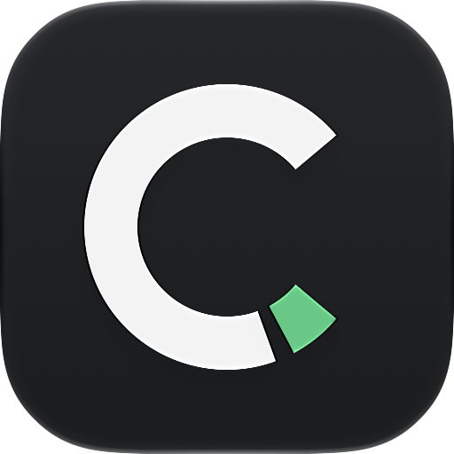

<p align="center"></p>

# Cleany

**See what is draining your Mac's battery, and stop the idle culprits in one click.**
A menu bar app, a window and a widget for macOS 26. Its mark sits in your menu bar and splits off a
small stretch when something idle can be cleaned up. Cleany never touches anything that is in use.

Built for developers: forgotten iOS Simulators, Docker containers, dev servers, idle apps and
runaway browser tabs are what usually eat the battery.

## Features

- **The creek band.** Each category gets a stretch of the strip as wide as its exact share of the
  CPU in use, and the idle part of each stretch is green. You see the cause, and what you can get
  back, before you read anything.
- **Quick select** ticks everything idle. **Choose myself** leaves the ticks to you.
- **Every item explains itself.** The **?** says what it is, why Cleany thinks it is idle or in use,
  and what you lose by stopping it.
- **Keep** an item and Quick select never ticks it again. **Undo** brings back what a cleanup stopped.
- **Warns, never acts alone.** A notification when the battery drains fast and idle items are to
  blame, with a "Clean up N idle" button.
- **Menu bar, ⌃⌥⌘C from anywhere, and a widget** do the whole job without opening the window.
- **History** in Settings: what each cleanup stopped and the CPU it gave back.

Nothing shows as idle for the first 10 to 30 minutes after launch or wake: Cleany watches first.
No network, no analytics, no accounts.

## Build

Requires macOS 26, Xcode 26+ and [XcodeGen](https://github.com/yonaskolb/XcodeGen).

```sh
cp Config/Team.xcconfig.example Config/Team.xcconfig   # set your Apple Developer Team ID
xcodegen generate
xcodebuild -project Cleany.xcodeproj -scheme Cleany build
swift test --package-path Packages/CleanyCore           # the detection engine's tests
```

The widget and the app share snapshots through the App Group `$(DEVELOPMENT_TEAM).app.cleany`, so
the widget needs a real team. The app icon is an Icon Composer file (`App/AppIcon.icon`, layered SVGs
that macOS renders in Liquid Glass); `Scripts/render-icon.sh` exports `docs/icon.png` from it.

Debug builds take `-debugDemo YES` (a made-up busy Mac, cleanups are dry runs), `-dryRunCleanup YES`,
`-debugOpen main|popover` and `-debugAppearance dark|light`.

## Credits

Cleany is a redesign of [CleanUp](https://github.com/TheoInTech/CleanUp) by Vincent Theo Roque.
Its detection engine (`Packages/CleanyCore`) comes from CleanUp, under the MIT License.
See [LICENSE](LICENSE).
